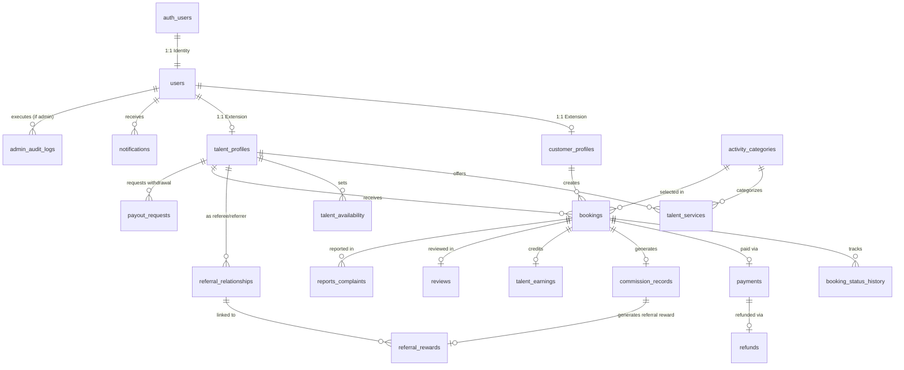

# DOKUMEN ARSITEKTUR BACKEND DAN PERANCANGAN DATABASE YUKU (FINALISASI TAHAP 2.1)

**Produk**: YUKU — Social Experience & Paid Companionship Marketplace  
**Tagline**: *Real Friends. Real Moments.*  
**Dokumen**: Spesifikasi Arsitektur Database & Integrasi Supabase (Finalisasi Tahap 2.1)  
**Tanggal**: November 2026  
**Status**: FINAL DRAFT (Siap Menunggu Eksekusi Tahap 2.2 Setelah Validasi Provider/Hukum)

---

## 1. RINGKASAN ARSITEKTUR & PRINSIP DESAIN

Arsitektur backend YUKU dirancang menggunakan **Supabase (PostgreSQL 15+)** dengan mengutamakan isolasi peran, keamanan data identitas, transparansi histori keuangan (*auditable ledger*), dan abstraksi penyedia pembayaran (*provider-independent payment architecture*):

1. **Database Core (PostgreSQL 15+)**:
   - Memanfaatkan database relasional ACID-compliant.
   - Enforcing integritas data keuangan, *audit trail*, dan *constraint* bisnis di tingkat database.
   - Ekstensi PostgreSQL yang digunakan: `uuid-ossp` (generasi UUID v4), `btree_gist` (pengecekan klausa *exclusion constraint* pencegah bentrok jadwal), dan `pg_trgm` (pencarian kata kunci talent & lokasi).

2. **Abstraksi Payment Gateway (Provider-Independent Adapter)**:
   - Kandidat Provider Utama: **Xendit XenPlatform** (Split Payments & Sub-accounts).
   - Kandidat Provider Alternatif: **Midtrans**.
   - Sistem tidak bergantung pada satu *vendor* spesifik. Seluruh komunikasi payment gateway dibungkus oleh antarmuka *adapter* (`PaymentProviderAdapter`).
   - **Catatan Validasi Hukum & Provider**: Mekanisme penampungan dan *split payment* marketplace harus mendapatkan persetujuan tertulis dari penyedia payment gateway serta divalidasi secara hukum sebelum integrasi produksi.

3. **Separasi Status & Pelepasan Dana (24-Hour Hold Window)**:
   - Pembayaran (*PaymentStatus*) dan Pencairan (*PayoutStatus*) dikelola secara terpisah.
   - Setelah sesi booking berstatus `completed`, dana ditahan selama **24 jam** (*Complaint Window*).
   - Customer memiliki waktu 24 jam untuk mengajukan komplain. Jika ada komplain, pelepasan dana ditangguhkan (*disputed / hold*).
   - Eksekusi pencairan dana (*payout*) hanya berstatus `completed` setelah menerima konfirmasi *webhook* terverifikasi dari penyedia gateway.
   - Menggunakan *idempotency keys* dan *HMAC signature verification* pada seluruh endpoint webhook untuk mencegah eksekusi ganda.

4. **Verifikasi Identitas & Privasi KTP**:
   - Pada tahap awal, verifikasi KTP dilakukan secara **manual oleh Admin**.
   - Berkas KTP disimpan di *Private Bucket* Supabase (`identity-documents`) tanpa akses publik.
   - Akses Admin menggunakan *Signed URL* berdurasi maksimal 300 detik (5 menit) dan setiap aktivitas akses dicatat pada `admin_audit_logs`.
   - **Penegasan Tahap 1**: Pengumpulan KTP belum aktif pada Tahap 1 saat ini.

---

## 2. ARSITEKTUR PAYMENT GATEWAY & ADAPTER PATTERN

Untuk memastikan arsitektur *provider-independent*, backend YUKU mendefinisikan kontrak antarmuka *adapter*:

```typescript
export interface PaymentProviderAdapter {
  providerName: 'xendit' | 'midtrans';
  
  // 1. Inisiasi Tagihan / Charge
  createCharge(params: {
    bookingCode: string;
    grossAmount: number;
    customerEmail: string;
    customerName: string;
    paymentMethod: string;
  }): Promise<{
    paymentReferenceId: string;
    checkoutUrl?: string;
    qrCodeUrl?: string;
    virtualAccountNumber?: string;
    expiresAt: Date;
  }>;

  // 2. Verifikasi Tanda Tangan Webhook (HMAC Signature)
  verifyWebhookSignature(
    rawBody: string,
    signatureHeader: string
  ): boolean;

  // 3. Pelepasan Settlement / Split Transfer ke Sub-Account Talent
  releaseSettlement(params: {
    paymentReferenceId: string;
    talentSubAccountId?: string;
    talentGrossShare: number;
    platformCommissionAmount: number;
    idempotencyKey: string;
  }): Promise<{
    success: boolean;
    settlementTxId: string;
  }>;

  // 4. Inisiasi Payout / Disbursement ke Bank Talent
  createPayout(params: {
    payoutNumber: string;
    amount: number;
    bankCode: string;
    accountNumber: string;
    accountHolderName: string;
    idempotencyKey: string;
  }): Promise<{
    payoutProviderRef: string;
    status: 'pending' | 'processing' | 'completed' | 'failed';
  }>;
}
```

---

## 3. DIAGRAM RELASI DATABASE (ERD UPDATED)



---

## 4. DETIL SCHEMA 19 TABEL DATABASE

### 4.1. Tabel `users`
Tabel utama pengguna yang tersinkronisasi dengan `auth.users`.
- `id` (UUID, Primary Key, Foreign Key -> `auth.users.id` ON DELETE CASCADE)
- `email` (VARCHAR(255), Unique, Not Null)
- `phone_number` (VARCHAR(30), Unique, Nullable)
- `role` (ENUM('customer', 'talent', 'admin'), Not Null, Default 'customer')
- `is_verified_18` (BOOLEAN, Not Null, Default FALSE)
- `account_status` (ENUM('pending_verification', 'active', 'suspended', 'banned'), Not Null, Default 'pending_verification')
- `created_at` (TIMESTAMPTZ, Not Null, Default NOW())
- `updated_at` (TIMESTAMPTZ, Not Null, Default NOW())

---

### 4.2. Tabel `customer_profiles`
Profil spesifik untuk pengguna berkategori Customer.
- `id` (UUID, Primary Key, Foreign Key -> `users.id` ON DELETE CASCADE)
- `full_name` (VARCHAR(150), Not Null)
- `avatar_url` (TEXT, Nullable)
- `city` (VARCHAR(100), Not Null)
- `gender` (ENUM('Pria', 'Wanita'), Not Null)
- `date_of_birth` (DATE, Not Null)
- `emergency_contact_phone` (VARCHAR(30), Nullable)
- `bio` (TEXT, Nullable)
- `created_at` (TIMESTAMPTZ, Not Null, Default NOW())
- `updated_at` (TIMESTAMPTZ, Not Null, Default NOW())

---

### 4.3. Tabel `talent_profiles`
Profil spesifik untuk penyedia jasa pertemanan (Talent).
- `id` (UUID, Primary Key, Foreign Key -> `users.id` ON DELETE CASCADE)
- `full_name` (VARCHAR(150), Not Null)
- `display_name` (VARCHAR(100), Not Null)
- `avatar_url` (TEXT, Not Null)
- `city` (VARCHAR(100), Not Null)
- `gender` (ENUM('Pria', 'Wanita'), Not Null)
- `date_of_birth` (DATE, Not Null)
- `headline` (VARCHAR(200), Not Null)
- `bio` (TEXT, Not Null)
- `hourly_rate` (NUMERIC(12, 2), Not Null, Check > 0)
- `online_chat_rate` (NUMERIC(12, 2), Nullable, Check > 0)
- `service_mode` (ENUM('Offline & Online', 'Offline Only', 'Online Only'), Not Null, Default 'Offline & Online')
- `rating_average` (NUMERIC(3, 2), Not Null, Default 5.00)
- `review_count` (INT, Not Null, Default 0)
- `completed_hours` (INT, Not Null, Default 0)
- `languages` (TEXT[], Not Null, Default '{}')
- `interests` (TEXT[], Not Null, Default '{}')
- `referral_code` (VARCHAR(20), Unique, Not Null) -- Kode rujukan unik talent
- `ktp_storage_path` (TEXT, Nullable) -- Path file di private bucket
- `ktp_verification_status` (ENUM('unsubmitted', 'pending_review', 'verified', 'rejected'), Not Null, Default 'unsubmitted')
- `ktp_rejection_reason` (TEXT, Nullable)
- `created_at` (TIMESTAMPTZ, Not Null, Default NOW())
- `updated_at` (TIMESTAMPTZ, Not Null, Default NOW())

---

### 4.4. Tabel `activity_categories`
Daftar kategori aktivitas sosial (Ngopi, Jalan-jalan, Nonton film, Acara, dsb).
- `id` (VARCHAR(50), Primary Key) -- e.g., 'ngopi-makan', 'nonton-film'
- `title` (VARCHAR(100), Not Null)
- `description` (TEXT, Not Null)
- `icon_name` (VARCHAR(50), Not Null)
- `examples` (TEXT[], Not Null, Default '{}')
- `is_online_available` (BOOLEAN, Not Null, Default FALSE)
- `is_active` (BOOLEAN, Not Null, Default TRUE)
- `created_at` (TIMESTAMPTZ, Not Null, Default NOW())

---

### 4.5. Tabel `talent_services`
Peta layanan aktivitas yang didukung oleh setiap Talent.
- `id` (UUID, Primary Key, Default gen_random_uuid())
- `talent_id` (UUID, Not Null, Foreign Key -> `talent_profiles.id` ON DELETE CASCADE)
- `activity_category_id` (VARCHAR(50), Not Null, Foreign Key -> `activity_categories.id`)
- `custom_rate_override` (NUMERIC(12, 2), Nullable)
- `created_at` (TIMESTAMPTZ, Not Null, Default NOW())
- UNIQUE (`talent_id`, `activity_category_id`)

---

### 4.6. Tabel `talent_availability`
Pengaturan ketersediaan hari/jam atau tanggal spesifik Talent.
- `id` (UUID, Primary Key, Default gen_random_uuid())
- `talent_id` (UUID, Not Null, Foreign Key -> `talent_profiles.id` ON DELETE CASCADE)
- `day_of_week` (INT, Nullable, Check 0-6) -- 0=Minggu, 6=Sabtu
- `specific_date` (DATE, Nullable)
- `start_time` (TIME, Not Null)
- `end_time` (TIME, Not Null)
- `is_available` (BOOLEAN, Not Null, Default TRUE)
- `created_at` (TIMESTAMPTZ, Not Null, Default NOW())

---

### 4.7. Tabel `bookings`
Data utama pemesanan sesi pertemanan sosial.
- `id` (UUID, Primary Key, Default gen_random_uuid())
- `booking_code` (VARCHAR(20), Unique, Not Null) -- e.g., 'YK-20261109-88A9'
- `customer_id` (UUID, Not Null, Foreign Key -> `customer_profiles.id`)
- `talent_id` (UUID, Not Null, Foreign Key -> `talent_profiles.id`)
- `activity_category_id` (VARCHAR(50), Not Null, Foreign Key -> `activity_categories.id`)
- `booking_mode` (ENUM('offline', 'online'), Not Null)
- `start_time` (TIMESTAMPTZ, Not Null)
- `end_time` (TIMESTAMPTZ, Not Null)
- `duration_hours` (NUMERIC(4, 2), Not Null, Check > 0)
- `meeting_location_name` (VARCHAR(200), Not Null) -- Tempat umum/publik
- `meeting_location_address` (TEXT, Nullable)
- `hourly_rate_snapshot` (NUMERIC(12, 2), Not Null) -- Snapshot dari server
- `gross_amount` (NUMERIC(12, 2), Not Null) -- Total nilai booking
- `platform_fee_amount` (NUMERIC(12, 2), Not Null) -- 20% komisi YUKU
- `talent_gross_share` (NUMERIC(12, 2), Not Null) -- 80% bagian Talent
- `status` (ENUM('pending_payment', 'paid_held_in_escrow', 'confirmed_by_talent', 'in_progress', 'completed', 'disputed_hold', 'cancelled_by_customer', 'cancelled_by_talent', 'refunded'), Not Null, Default 'pending_payment')
- `completion_confirmed_at` (TIMESTAMPTZ, Nullable) -- Waktu sesi ditandai selesai
- `escrow_release_scheduled_at` (TIMESTAMPTZ, Nullable) -- Waktu pelepasan dana (+24 jam)
- `cancellation_reason` (TEXT, Nullable)
- `created_at` (TIMESTAMPTZ, Not Null, Default NOW())
- `updated_at` (TIMESTAMPTZ, Not Null, Default NOW())
- CONSTRAINT `check_booking_times` CHECK (`end_time` > `start_time`)

---

### 4.8. Tabel `booking_status_history`
Histori perubahan status booking (*audit trail* transisi status).
- `id` (UUID, Primary Key, Default gen_random_uuid())
- `booking_id` (UUID, Not Null, Foreign Key -> `bookings.id` ON DELETE CASCADE)
- `previous_status` (VARCHAR(50), Nullable)
- `new_status` (VARCHAR(50), Not Null)
- `changed_by_user_id` (UUID, Not Null, Foreign Key -> `users.id`)
- `notes` (TEXT, Nullable)
- `created_at` (TIMESTAMPTZ, Not Null, Default NOW())

---

### 4.9. Tabel `payments`
Catatan transaksi pembayaran (*separasi status pembayaran*).
- `id` (UUID, Primary Key, Default gen_random_uuid())
- `booking_id` (UUID, Unique, Not Null, Foreign Key -> `bookings.id`)
- `provider` (ENUM('xendit', 'midtrans'), Not Null, Default 'xendit')
- `provider_charge_id` (VARCHAR(100), Unique, Nullable) -- Reference ID dari gateway
- `payment_method` (VARCHAR(50), Not Null) -- e.g., 'qris', 'bank_transfer'
- `amount` (NUMERIC(12, 2), Not Null)
- `payment_status` (ENUM('pending', 'settled_held', 'released_to_talent', 'disputed_hold', 'refunded', 'failed', 'expired'), Not Null, Default 'pending')
- `paid_at` (TIMESTAMPTZ, Nullable)
- `escrow_released_at` (TIMESTAMPTZ, Nullable)
- `idempotency_key` (UUID, Unique, Not Null, Default gen_random_uuid())
- `webhook_payload_history` (JSONB[], Not Null, Default '{}')
- `created_at` (TIMESTAMPTZ, Not Null, Default NOW())
- `updated_at` (TIMESTAMPTZ, Not Null, Default NOW())

---

### 4.10. Tabel `refunds`
Catatan pengembalian dana (*refund*) kepada Customer.
- `id` (UUID, Primary Key, Default gen_random_uuid())
- `payment_id` (UUID, Not Null, Foreign Key -> `payments.id`)
- `booking_id` (UUID, Not Null, Foreign Key -> `bookings.id`)
- `customer_id` (UUID, Not Null, Foreign Key -> `customer_profiles.id`)
- `refund_amount` (NUMERIC(12, 2), Not Null)
- `reason` (TEXT, Not Null)
- `provider_refund_id` (VARCHAR(100), Nullable)
- `status` (ENUM('requested', 'approved', 'processed', 'rejected'), Not Null, Default 'requested')
- `processed_by_admin_id` (UUID, Nullable, Foreign Key -> `users.id`)
- `processed_at` (TIMESTAMPTZ, Nullable)
- `created_at` (TIMESTAMPTZ, Not Null, Default NOW())

---

### 4.11. Tabel `commission_records`
Rincian pembagian nilai komisi platform (20% YUKU) per transaksi booking.
- `id` (UUID, Primary Key, Default gen_random_uuid())
- `booking_id` (UUID, Unique, Not Null, Foreign Key -> `bookings.id`)
- `gross_booking_amount` (NUMERIC(12, 2), Not Null)
- `platform_commission_amount` (NUMERIC(12, 2), Not Null) -- 20% dari total booking
- `talent_gross_share` (NUMERIC(12, 2), Not Null) -- 80% dari total booking
- `referral_payout_reserved` (NUMERIC(12, 2), Not Null, Default 0) -- 10% dari komisi YUKU
- `net_platform_revenue` (NUMERIC(12, 2), Not Null) -- Komisi YUKU bersih setelah cadangan referral
- `created_at` (TIMESTAMPTZ, Not Null, Default NOW())

---

### 4.12. Tabel `talent_earnings`
Buku besar (*ledger*) pendapatan Talent per booking.
- `id` (UUID, Primary Key, Default gen_random_uuid())
- `talent_id` (UUID, Not Null, Foreign Key -> `talent_profiles.id`)
- `booking_id` (UUID, Unique, Not Null, Foreign Key -> `bookings.id`)
- `gross_earning` (NUMERIC(12, 2), Not Null) -- 80% dari nilai booking
- `tax_withheld` (NUMERIC(12, 2), Not Null, Default 0)
- `transfer_fee` (NUMERIC(12, 2), Not Null, Default 0)
- `net_earning` (NUMERIC(12, 2), Not Null)
- `status` (ENUM('held_in_escrow', 'disputed_hold', 'available_for_payout', 'paid_out', 'forfeited'), Not Null, Default 'held_in_escrow')
- `available_at` (TIMESTAMPTZ, Nullable) -- Ditentukan +24 jam setelah booking completed jika tidak ada komplain
- `created_at` (TIMESTAMPTZ, Not Null, Default NOW())

---

### 4.13. Tabel `referral_relationships`
Hubungan rujukan 1 tingkat antarpengguna/Talent.
- `id` (UUID, Primary Key, Default gen_random_uuid())
- `referrer_id` (UUID, Not Null, Foreign Key -> `users.id`) -- Pengundang
- `referee_talent_id` (UUID, Unique, Not Null, Foreign Key -> `talent_profiles.id`) -- Talent yang diundang (1 Talent hanya punya 1 referrer)
- `referral_code_used` (VARCHAR(20), Not Null)
- `is_active` (BOOLEAN, Not Null, Default TRUE)
- `created_at` (TIMESTAMPTZ, Not Null, Default NOW())
- CONSTRAINT `check_no_self_referral` CHECK (`referrer_id` <> `referee_talent_id`)

---

### 4.14. Tabel `referral_rewards`
Catatan reward referral (10% dari komisi 20% YUKU) dari transaksi valid, selesai, dan terverifikasi.
- `id` (UUID, Primary Key, Default gen_random_uuid())
- `referral_relationship_id` (UUID, Not Null, Foreign Key -> `referral_relationships.id`)
- `booking_id` (UUID, Unique, Not Null, Foreign Key -> `bookings.id`)
- `referrer_id` (UUID, Not Null, Foreign Key -> `users.id`)
- `platform_commission_base` (NUMERIC(12, 2), Not Null) -- Nilai komisi YUKU (20%)
- `reward_amount` (NUMERIC(12, 2), Not Null) -- 10% dari `platform_commission_base`
- `status` (ENUM('pending_completion', 'credited', 'cancelled_disputed'), Not Null, Default 'pending_completion')
- `credited_at` (TIMESTAMPTZ, Nullable)
- `created_at` (TIMESTAMPTZ, Not Null, Default NOW())

---

### 4.15. Tabel `payout_requests`
Permintaan penarikan/pencairan saldo pendapatan Talent (*separasi status payout*).
- `id` (UUID, Primary Key, Default gen_random_uuid())
- `payout_number` (VARCHAR(20), Unique, Not Null) -- e.g., 'PO-20261109-0012'
- `talent_id` (UUID, Not Null, Foreign Key -> `talent_profiles.id`)
- `amount` (NUMERIC(12, 2), Not Null, Check >= 100000) -- Minimum Rp100.000
- `bank_name` (VARCHAR(50), Not Null)
- `bank_account_number` (VARCHAR(50), Not Null)
- `bank_account_holder_name` (VARCHAR(150), Not Null)
- `payout_provider` (ENUM('xendit', 'midtrans'), Not Null, Default 'xendit')
- `payout_provider_ref` (VARCHAR(100), Unique, Nullable)
- `idempotency_key` (UUID, Unique, Not Null, Default gen_random_uuid())
- `payout_status` (ENUM('requested', 'processing', 'completed_provider_confirmed', 'rejected', 'failed'), Not Null, Default 'requested')
- `rejection_reason` (TEXT, Nullable)
- `processed_by_admin_id` (UUID, Nullable, Foreign Key -> `users.id`)
- `provider_confirmed_at` (TIMESTAMPTZ, Nullable)
- `created_at` (TIMESTAMPTZ, Not Null, Default NOW())

---

### 4.16. Tabel `reviews`
Ulasan dan rating dari Customer untuk Talent pasca-sesi booking selesai.
- `id` (UUID, Primary Key, Default gen_random_uuid())
- `booking_id` (UUID, Unique, Not Null, Foreign Key -> `bookings.id`)
- `customer_id` (UUID, Not Null, Foreign Key -> `customer_profiles.id`)
- `talent_id` (UUID, Not Null, Foreign Key -> `talent_profiles.id`)
- `rating` (INT, Not Null, Check (rating >= 1 AND rating <= 5))
- `review_text` (TEXT, Nullable)
- `is_visible` (BOOLEAN, Not Null, Default TRUE)
- `created_at` (TIMESTAMPTZ, Not Null, Default NOW())

---

### 4.17. Tabel `reports_complaints`
Laporan insiden / komplain dalam jendela 24 jam.
- `id` (UUID, Primary Key, Default gen_random_uuid())
- `reporter_id` (UUID, Not Null, Foreign Key -> `users.id`)
- `reported_user_id` (UUID, Not Null, Foreign Key -> `users.id`)
- `booking_id` (UUID, Nullable, Foreign Key -> `bookings.id`)
- `category` (ENUM('unethical_behavior', 'dating_sexual_solicitation', 'no_show', 'safety_concern', 'service_dispute', 'other'), Not Null)
- `description` (TEXT, Not Null)
- `evidence_urls` (TEXT[], Not Null, Default '{}')
- `status` (ENUM('open', 'investigating', 'resolved_action_taken', 'dismissed'), Not Null, Default 'open')
- `admin_notes` (TEXT, Nullable)
- `resolved_by_admin_id` (UUID, Nullable, Foreign Key -> `users.id`)
- `created_at` (TIMESTAMPTZ, Not Null, Default NOW())

---

### 4.18. Tabel `notifications`
Notifikasi dalam sistem untuk pengguna.
- `id` (UUID, Primary Key, Default gen_random_uuid())
- `user_id` (UUID, Not Null, Foreign Key -> `users.id` ON DELETE CASCADE)
- `title` (VARCHAR(150), Not Null)
- `message` (TEXT, Not Null)
- `type` (ENUM('booking_update', 'payment_status', 'referral_bonus', 'payout_status', 'system_alert'), Not Null)
- `is_read` (BOOLEAN, Not Null, Default FALSE)
- `metadata` (JSONB, Nullable)
- `created_at` (TIMESTAMPTZ, Not Null, Default NOW())

---

### 4.19. Tabel `admin_audit_logs`
Catatan jejak audit (*audit log*) aktivitas admin dan akses dokumen privat.
- `id` (UUID, Primary Key, Default gen_random_uuid())
- `admin_user_id` (UUID, Not Null, Foreign Key -> `users.id`)
- `action_type` (VARCHAR(100), Not Null) -- e.g., 'ACCESS_KTP_DOCUMENT', 'APPROVE_PAYOUT', 'SUSPEND_USER'
- `target_table` (VARCHAR(50), Not Null)
- `target_id` (VARCHAR(100), Not Null)
- `old_data` (JSONB, Nullable)
- `new_data` (JSONB, Nullable)
- `ip_address` (VARCHAR(45), Nullable)
- `created_at` (TIMESTAMPTZ, Not Null, Default NOW())

---

## 5. INDEKS DATABASE UNTUK PERFORMA TINGGI & PENCEGAHAN BENTROK

1. **Pencegahan Bentrok Jadwal Booking (Exclusion Constraint / GIST Index)**:
   - Klausa `EXCLUDE USING gist` pada `bookings` memastikan tidak ada dua booking berstatus aktif (`paid_held_in_escrow`, `confirmed_by_talent`, `in_progress`) milik `talent_id` yang sama dengan rentang waktu `tstzrange(start_time, end_time)` yang tumpang tindih.

2. **Indeks Transaksi, Webhook & Idempotency**:
   - `idx_payments_idempotency` ON `payments(idempotency_key)`
   - `idx_payments_provider_ref` ON `payments(provider_charge_id)`
   - `idx_payout_idempotency` ON `payout_requests(idempotency_key)`
   - `idx_bookings_escrow_hold` ON `bookings(status, escrow_release_scheduled_at)`

---

## 6. RANCANGAN ROW LEVEL SECURITY (RLS) PER ROLE

Prinsip *Least Privilege* diterapkan pada seluruh tabel:

| Tabel | Role: Public (Anon) | Role: Customer | Role: Talent | Role: Admin |
| :--- | :--- | :--- | :--- | :--- |
| `users` | Denied | SELECT (milik sendiri) | SELECT (milik sendiri) | SELECT, UPDATE (semua) |
| `customer_profiles` | Denied | ALL (milik sendiri) | SELECT (hanya jika ada booking aktif) | ALL (semua) |
| `talent_profiles` | SELECT (profil publik) | SELECT (profil publik) | ALL (profil sendiri) | ALL (semua) |
| `talent_availability` | SELECT (ketersediaan) | SELECT (ketersediaan) | ALL (jadwal sendiri) | ALL (semua) |
| `bookings` | Denied | SELECT, INSERT (milik sendiri) | SELECT, UPDATE (status booking sendiri) | ALL (semua) |
| `payments` | Denied | SELECT (pembayaran sendiri) | SELECT (terkait booking sendiri) | ALL (semua) |
| `refunds` | Denied | SELECT (refund sendiri) | Denied | ALL (semua) |
| `commission_records` | Denied | Denied | Denied | ALL (hanya Admin & System) |
| `talent_earnings` | Denied | Denied | SELECT (ledger sendiri) | ALL (semua) |
| `referral_relationships` | Denied | SELECT (jika referrer/referee) | SELECT (jika referrer/referee) | ALL (semua) |
| `referral_rewards` | Denied | SELECT (reward milik sendiri) | SELECT (reward milik sendiri) | ALL (semua) |
| `payout_requests` | Denied | Denied | SELECT, INSERT (pencairan sendiri) | ALL (semua) |
| `reports_complaints` | Denied | INSERT, SELECT (laporan sendiri) | INSERT, SELECT (laporan sendiri) | ALL (semua) |
| `admin_audit_logs` | Denied | Denied | Denied | ALL (hanya Admin) |

---

## 7. ALUR DATA OPERASIONAL TERBARU

### 7.1. Alur Pembayaran & Payment Provider Adapter Flow
```text
[Customer] --(submit booking)--> [Server Validation Edge Function]
                                           |
                +--------------------------+--------------------------+
                | 1. Validasi usia 18+ customer & talent               |
                | 2. Cek bentrok jadwal via DB Exclusion Constraint    |
                | 3. Ambil hourly_rate snapshot dari DB                |
                | 4. Panggil PaymentProviderAdapter.createCharge()    |
                +------------------------------------------------------+
                                           |
                                [Payment Gateway]
                                           |
                      (Customer melakukan pembayaran)
                                           |
                 [Webhook POST to /api/webhooks/payment]
                                           |
                +--------------------------+--------------------------+
                | 1. Verifikasi HMAC Signature                         |
                | 2. Cek Idempotency Key (cegah double process)        |
                | 3. Set payment_status = 'settled_held'              |
                | 4. Set booking_status = 'paid_held_in_escrow'       |
                +------------------------------------------------------+
```

### 7.2. Alur Pelepasan Dana (24-Hour Hold Window) & Alur Komplain
```text
Sesi Booking Selesai -> Booking Status = 'completed':
  |
  +--> Set completion_confirmed_at = NOW()
  +--> Set escrow_release_scheduled_at = NOW() + INTERVAL '24 HOURS'
  |
  +---[ Jendela Komplain 24 Jam Aktif ]---+
  |                                       |
  | IF Customer Mengajukan Komplain (Report):
  |   1. Set booking status = 'disputed_hold'
  |   2. Set payment_status = 'disputed_hold'
  |   3. Set talent_earnings status = 'disputed_hold'
  |   4. Notifikasi Admin untuk Investigasi Manual
  |
  | ELSE IF 24 Jam Berlalu TANPA Komplain:
  |   1. Scheduled Job / Trigger mengeksekusi pelepasan dana
  |   2. Set payment_status = 'released_to_talent'
  |   3. Set talent_earnings status = 'available_for_payout'
  |   4. Hitung & cairkan referral reward 10% ke referrer ('credited')
```

### 7.3. Alur Komisi 20/80 & Referral 10% Satu Tingkat
```text
Saat Dana Siap Dilepas (24 Jam Bebas Komplain):
1. Gross Booking Amount = 100%
2. Talent Gross Share = 80% (sebelum potongan pajak/transfer bank)
3. Platform Commission Base = 20% (komisi YUKU)
4. Sistem memeriksa tabel `referral_relationships`:
   - Jika ADA referrer yang valid (1 tingkat, lain pengguna, terverifikasi):
     * Referral Reward = 10% * Platform Commission Base (10% dari komisi 20% YUKU).
     * Set status `referral_rewards` = 'credited'.
   - Jika TIDAK ADA:
     * Seluruh 20% menjadi pendapatan bersih YUKU.
```

### 7.4. Alur Pencairan Saldo Talent (Pemisahan Payout Status & Webhook Confirmation)
```text
[Talent] --(ajukan pencairan)--> [Server Validation]
                                        |
               +------------------------+------------------------+
               | 1. Cek total saldo 'available_for_payout' >= 100.000 |
               | 2. Panggil PaymentProviderAdapter.createPayout() |
               | 3. Set payout_status = 'processing'              |
               +-------------------------------------------------+
                                        |
                            [Payment Gateway Payout]
                                        |
                 [Webhook POST to /api/webhooks/payout]
                                        |
               +------------------------+------------------------+
               | 1. Verifikasi HMAC Signature                     |
               | 2. Set payout_status = 'completed_provider_confirmed'|
               | 3. Set talent_earnings status = 'paid_out'      |
               +-------------------------------------------------+
```

---

## 8. STRATEGI PRIVASI, VERIFIKASI KTP & ATURAN RETENSI DATA

1. **Pemeriksaan Manual Admin di Tahap Awal**:
   - Berkas e-KTP dan swafoto diunggah ke *private storage* Supabase `identity-documents`.
   - Tidak ada akses publik langsung (RLS Block ALL Public).
   - Akses Admin menggunakan *Signed URL* berdurasi maksimal **300 detik (5 menit)**.
   - Setiap tindakan membuka/melihat dokumen KTP dicatat otomatis pada `admin_audit_logs`.

2. **Aturan Retensi & Penghapusan Data KTP (Data Purging Policy)**:
   - Berkas KTP yang ditolak dalam verifikasi akan **dihapus permanen dari storage** dalam waktu **30 hari** jika tidak ada pengajuan ulang.
   - Saat akun pengguna ditutup/dihapus (*Right to be Forgotten* sesuai UU PDP), seluruh berkas identitas terkait di hapus permanen dari storage.

3. **Penegasan Tahap 1**:
   - Pengumpulan, penyimpanan, dan verifikasi KTP **belum aktif** pada Tahap 1 saat ini.

---

## 9. DAFTAR KEPUTUSAN YANG MASIH MEMBUTUHKAN VALIDASI PROVIDER & HUKUM

Sebelum memasuki Tahap 2.2 (Eksekusi Skrip SQL & Integrasi API), poin-poin berikut wajib divalidasi secara tertulis:

1. **Lisensi Marketplace & Split Payment Payment Gateway**:
   - Validasi persetujuan tertulis dari pihak **Xendit (XenPlatform)** atau **Midtrans** terkait fitur *split payment*, penampungan *settlement*, dan akun marketplace untuk bisnis pertemanan sosial (Non-Dating, Non-Sexual).
2. **Persetujuan Penahanan Dana 24 Jam**:
   - Konfirmasi teknis dan legalitas penahanan dana 24 jam (*24-hour dispute hold window*) sebelum *disbursement* ke Talent.
3. **Dokumen Kebijakan Privasi & Syarat Layanan Sebelum Pengumpulan KTP**:
   - Pengesahan dokumen Syarat & Ketentuan serta Kebijakan Privasi oleh konsultan hukum sebelum fitur pengunggahan KTP diaktifkan di Tahap 2.

---

> **CATATAN AKHIR TAHAP 2.1**: Seluruh dokumen arsitektur dan perancangan database ini telah difinalisasi. Tidak ada skrip SQL yang dieksekusi ke Supabase dan tidak ada fitur backend/transaksi yang diaktifkan pada aplikasi hingga rancangan ini mendapatkan persetujuan akhir Anda.
